# Machman
---
### A virtual machine manager for macOS using the Virtualization framework

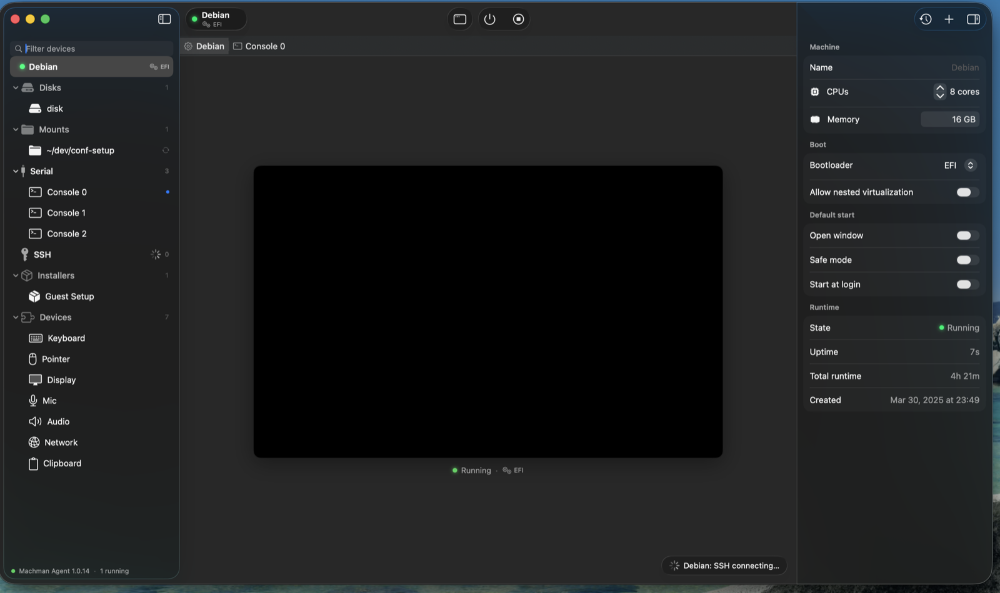

*A Debian VM just started: its devices on the left — disks, a shared folder, serial consoles,
SSH, Guest Setup — and its settings on the right.*

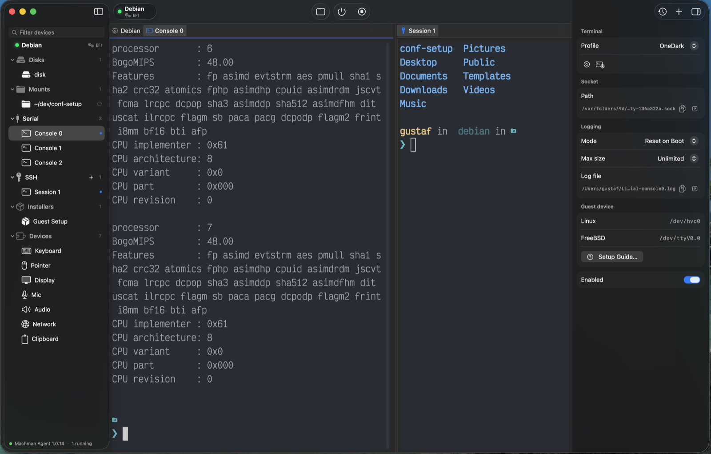

*Debian's serial console and an SSH session side by side, with the console's settings in the
inspector.*

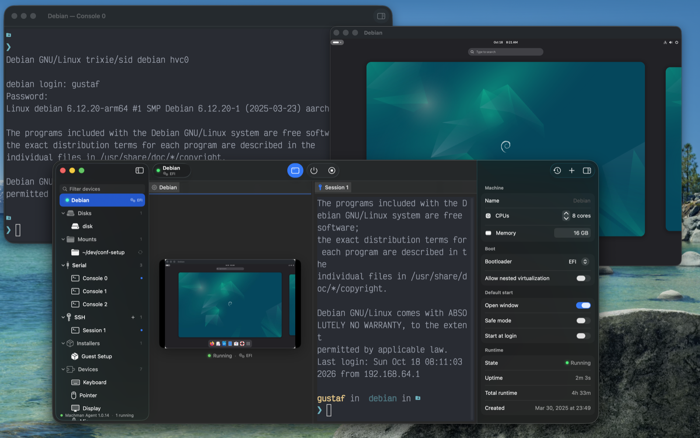

*Debian's display and a torn-off console in their own windows beside the main window's SSH
session.*

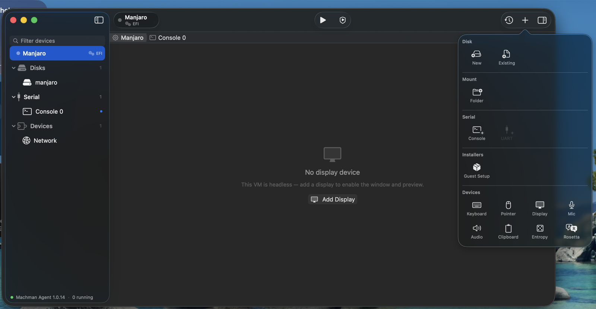

*The add menu on a headless Manjaro VM: disks, a shared folder, serial ports, the Guest Setup
installer and devices.*

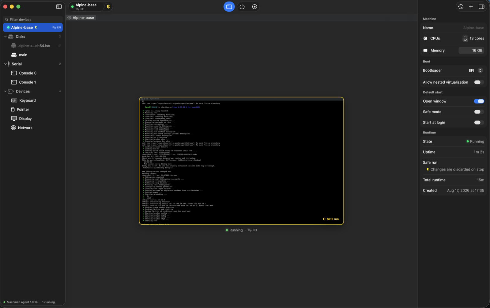

*Alpine in a safe run: its changes are discarded when it stops.*

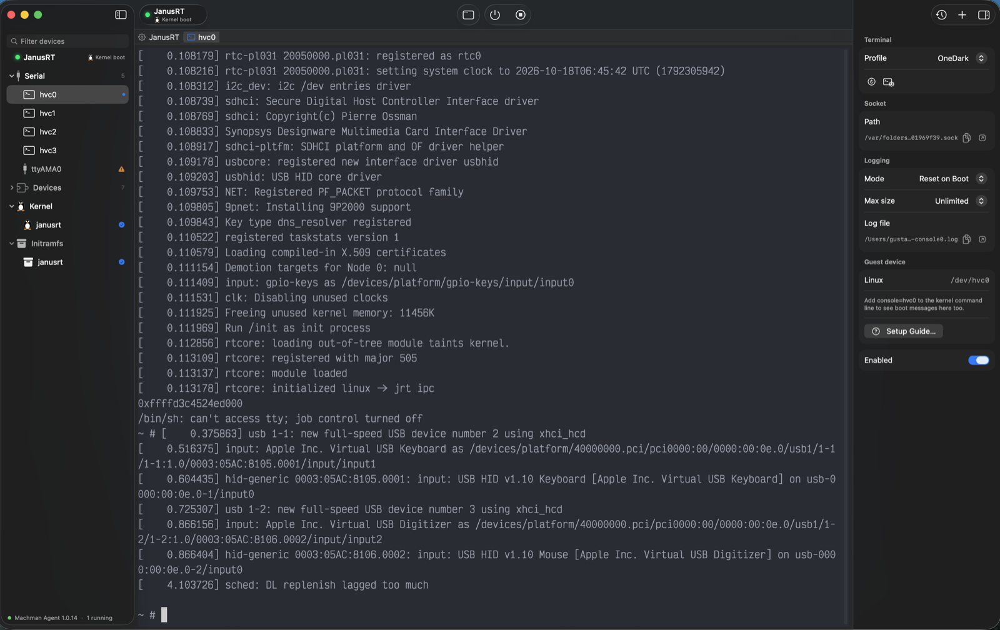

*A direct kernel boot — a Linux kernel and initramfs, no bootloader — with its boot log on the
hvc0 console.*

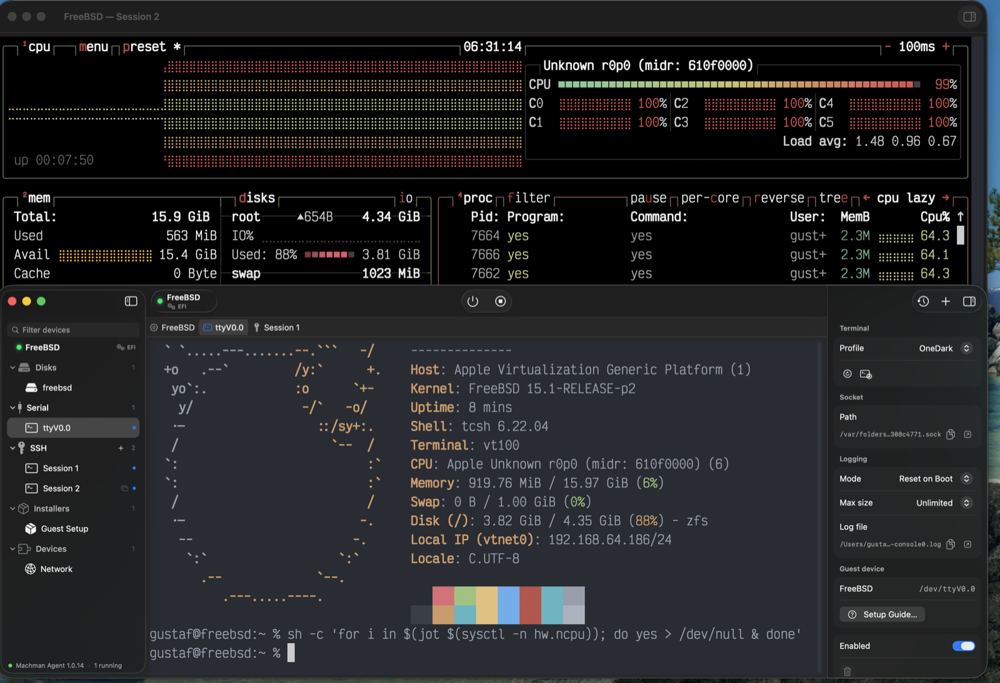

*FreeBSD 15.1 with every core busy: fastfetch on its virtio console, btop in an SSH session torn
off into its own window.*

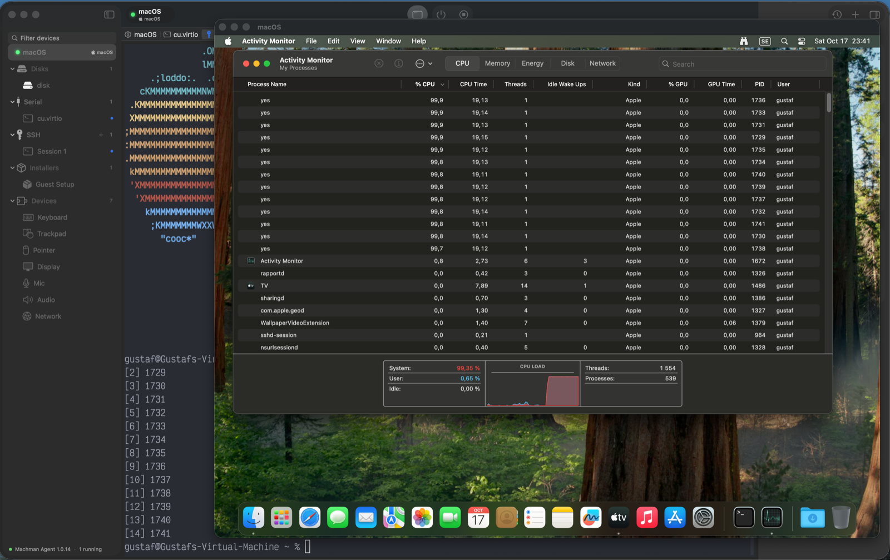

*A macOS guest under load: Activity Monitor in its display window, over the console and SSH
tabs.*

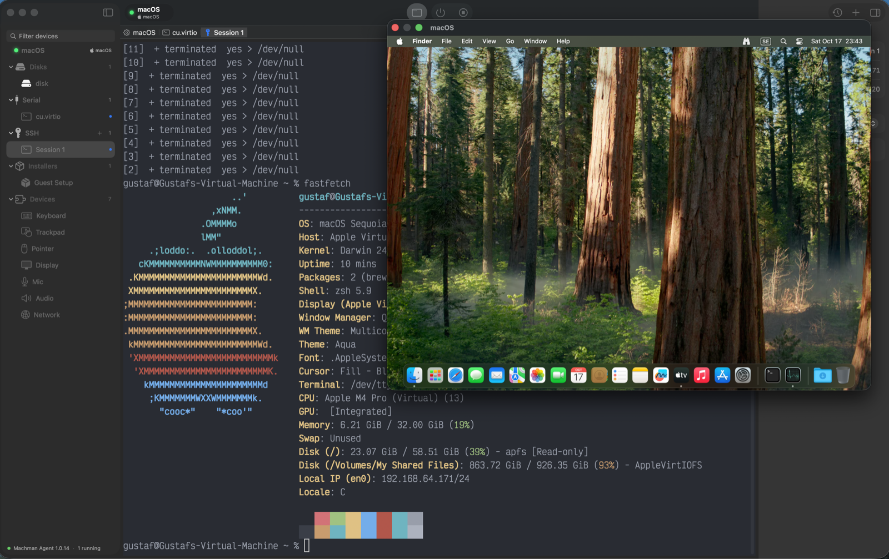

*A macOS guest's desktop beside fastfetch in an SSH session.*

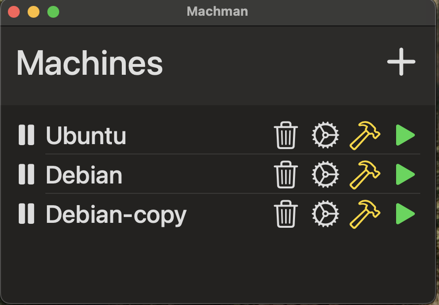

*Early development (2025): the Machines list with three stopped VMs.*

*Early development (2025): Debian and Ubuntu running in their own windows beside the Machines
list.*

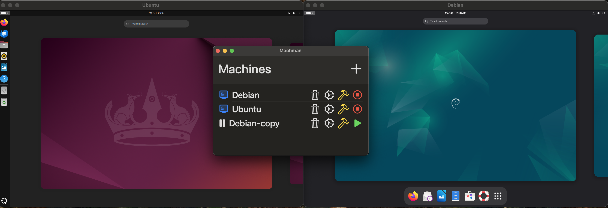

*Early development (2025): Ubuntu and Debian desktops running, with the Machines list in front.*

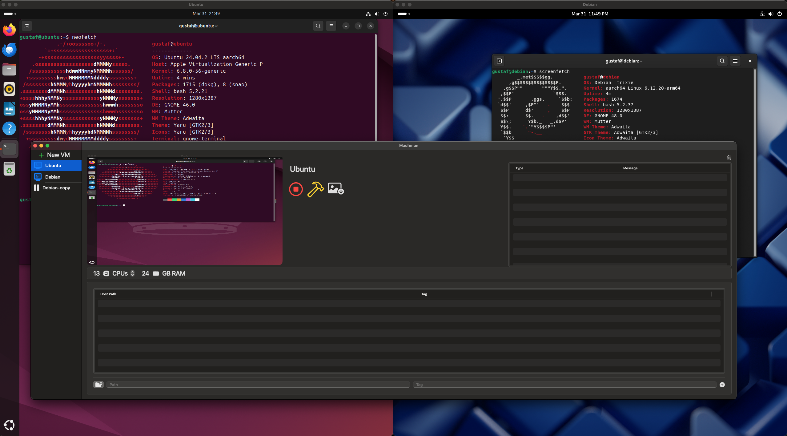

*Early development (2025): the sidebar window with a running Ubuntu VM, its preview and hardware
settings.*

*Early development (2025): the Debian VM selected, with its preview, disks and shared folders.*
